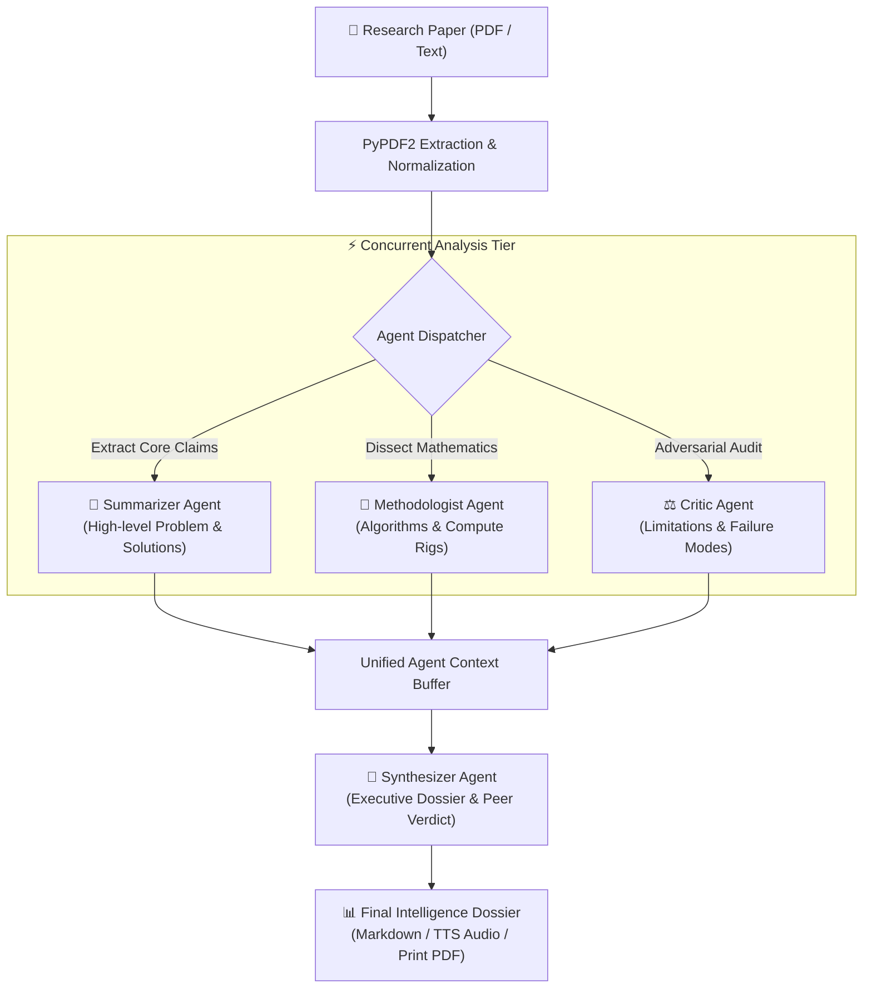

# Multi-Agent Systems For Research Paper Analysis And Knowledge Extraction

An innovative, multi-agent AI system designed to automate the reading, extraction, critiquing, and synthesis of academic research papers. Built specifically for the **Agentic AI** and **Data Analysis** domains, this application coordinates multiple specialized Large Language Model (LLM) agents working in a synchronized intelligence pipeline.

---

## 🌟 Key Features

*   **Vibrant & Modern UI (Flask + Glassmorphism Aurora):** Replaced Streamlit with a custom-engineered, high-performance Flask web application featuring ambient aurora mesh gradients, glassmorphism card surfaces, and neon-glowing agent themes.
*   **True Parallel Multi-Agent Execution:** The three primary analyst agents (**Summarizer**, **Methodologist**, and **Critic**) process the document concurrently in parallel, cutting wait time by over 60%.
*   **Four Specialized Autonomous Agent Roles:**
    1.  📝 **Summarizer Agent (Coral):** Distills core problems, architectural novelty, and quantifiable results.
    2.  🔬 **Methodologist Agent (Cyan):** Audits mathematical equations, neural layer configurations, loss functions, benchmarks, and training hyperparameters.
    3.  ⚖️ **Critic Agent (Amber):** Conducts an adversarial peer review searching for benchmark leakage, brittle assumptions, and reproducibility risks.
    4.  🧠 **Synthesizer Agent (Violet):** Unites all findings into an authoritative, strategic Executive Briefing with formal review recommendations.
*   **Interactive Real-Time Pipeline Visualizer:** Visual flowchart with glowing animated pulse connectors indicating the live state of each stage (PDF Ingestion ➜ Parallel Agent Cluster ➜ Executive Synthesis ➜ Final Dossier).
*   **One-Click Sample Paper Showcase:** Built-in rich excerpt of the seminal paper *"Attention Is All You Need"* (Vaswani et al.) for instant evaluation without needing to upload a file first.
*   **Audio Briefing (Text-to-Speech):** Integrated browser speech engine allowing researchers to listen to the executive briefing like an audio podcast.
*   **Multi-Format Export & Sharing:** Download full research dossiers as structured Markdown (`.md`), print/save to PDF, or copy individual card analyses with one click.
*   **Dynamic API Key & Model Configuration:** Configure your Gemini API key in the UI or via `.env`, test connections live, and select from supported models (e.g., `gemini-2.5-flash`, `gemini-2.0-flash`, `gemini-1.5-flash`, `gemini-1.5-pro`).

---

## 🏗 System Architecture



---

## 🚀 Getting Started

### Prerequisites
*   **Python 3.8+** installed on your system.
*   A **Google Gemini API Key** (obtainable for free from [Google AI Studio](https://aistudio.google.com/)).

---

### Installation

1.  **Open terminal and navigate to the project directory:**
    ```bash
    cd "G:\DSP Projects\Agentic AI\multi_agent_paper_analysis"
    ```

2.  **Activate your virtual environment:**
    *   **Windows (PowerShell):**
        ```powershell
        .\venv\Scripts\Activate.ps1
        ```
    *   **Windows (CMD):**
        ```cmd
        .\venv\Scripts\activate.bat
        ```
    *   **macOS / Linux:**
        ```bash
        source venv/bin/activate
        ```

3.  **Install dependencies:**
    ```bash
    pip install -r requirements.txt
    ```

4.  **Set up your API Key (Optional):**
    *   Copy `.env.example` to `.env`:
        ```bash
        copy .env.example .env
        ```
    *   Edit `.env` and insert your key:
        ```env
        GEMINI_API_KEY=your_gemini_api_key_here
        ```
    *   *(Alternatively, you can paste and test the key directly in the web UI).*

---

### Running the Application

Launch the Flask server:
```bash
python app.py
```

Open your web browser and navigate to:
```
http://localhost:5000
```

---

## 💡 How to Use the Analyzer

1.  **Configure API Key:** Click the status pill in the top-right header to input and test your Gemini API Key.
2.  **Provide a Research Paper:**
    *   *Option A:* Drag and drop any academic PDF into the dropzone.
    *   *Option B:* Click **"Try Sample Paper"** to immediately test with the built-in *Attention Is All You Need* excerpt.
    *   *Option C:* Switch to the "Paste / Inspect Text" tab to paste raw text.
3.  **Deploy Agent Team:** Click the radiant **"🚀 Deploy Agent Team"** button.
4.  **Watch Real-Time Execution:** Watch the live pipeline visualizer light up and the cards populate in real-time.
5.  **Review & Export:** Switch between 2x2 Grid View and Tabbed Focus View, listen to the audio briefing, or export the dossier as Markdown or PDF.

*(Note: The legacy Streamlit application has been preserved as `streamlit_app.py` for reference).*
